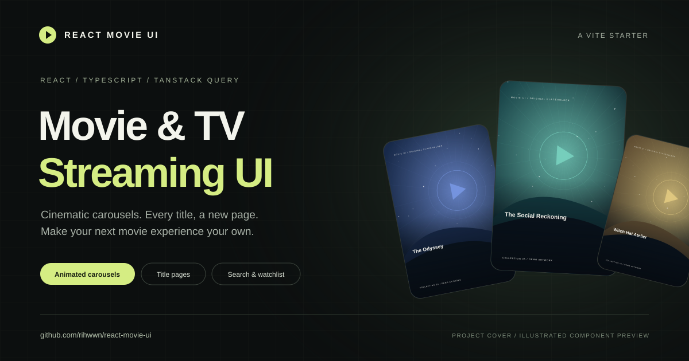

# React Movie UI

قالب رابط فیلم و سریال با **React، TypeScript، TanStack Query و Vite**؛ مناسب شروع یک وب‌سایت کشف فیلم یا استفاده از کامپوننت‌های آن در پروژهٔ شخصی.



[English documentation](README.md) · [اعتبار طراح و منابع](CREDITS.md)

## اجرا

Node.js نسخهٔ ۲۰ یا جدیدتر لازم است؛ پیشنهاد می‌شود از یک نسخهٔ LTS پشتیبانی‌شده استفاده کنید.

```sh
git clone https://github.com/rihwwn/react-movie-ui.git
cd react-movie-ui
npm ci
npm run dev
```

آدرس: **http://localhost:4173**. دمو به API key یا backend نیاز ندارد.

```sh
npm test
npm run typecheck
npm run build
npm run preview
```

خروجی در `dist/` ساخته می‌شود. سرور توسعه و preview پورت یکسان دارند؛ قبل از اجرای دیگری، سرور قبلی را متوقف کنید.

## امکانات

- اسلایدر با تغییر عرض، حرکت جهت‌دار، ورود مرحله‌ای متن، پخش خودکار، swipe و کیبورد.
- اسلایدر پیشنهادها با کارت میانی روشن و کارت‌های کناری سایه‌دار.
- حرکت ردیف‌ها در جهت مخالف، بدون تکثیر کارت در مجموعه‌های کوتاه.
- ورود هنگام اسکرول، دکمهٔ مکث و رعایت تنظیم کاهش حرکت سیستم.
- جست‌وجو، دسته‌بندی و فهرست تماشای محلی.
- صفحهٔ اختصاصی فیلم و سریال، عوامل، داستان، اطلاعات فنی و پیشنهادهای مرتبط.
- انتخاب فصل، فهرست قسمت‌ها و پلیر نمونه.
- لینک مستقیم، رفرش و Back/Forward مرورگر.
- دریافت داده و کش با React Query، اعتبارسنجی پاسخ و مدیریت بارگذاری و خطا.

## شخصی‌سازی

| فایل | کاربرد |
| --- | --- |
| `src/content.ts` | نام، متن‌ها و شناسهٔ فیلم‌های بخش‌های اصلی |
| `public/catalog.json` | کاتالوگ، دسته‌ها و مسیر تصاویر |
| `src/titleDetails.ts` | عوامل و اطلاعات نمایشی فصل‌ها |
| `src/styles.css` | ظاهر، واکنش‌گرایی و انیمیشن‌ها |
| `src/catalog.ts` | مدل داده، endpoint و اعتبارسنجی API |
| `src/components/TitlePage.tsx` | جزئیات عنوان، قسمت‌ها و پلیر |

با تغییر کاتالوگ، شناسه‌های `content.ts` و `titleDetails.ts` را هماهنگ کنید. این انتشار یک پروژهٔ آمادهٔ Vite است؛ کامپوننت‌ها همراه با استایل‌هایشان قابل انتقال به پروژهٔ React دیگرند.

## اتصال API و انتشار

دمو `/catalog.json` را می‌خواند. برای API واقعی، endpoint و اعتبارسنجی `src/catalog.ts` را با قرارداد سرور تطبیق دهید. اعتبارسنج فعلی فقط مسیرهای محلی `assets/` با نام انگلیسی کوچک و خط تیره و پسوند SVG، JPG، PNG یا WebP را می‌پذیرد؛ تصاویر ریموت به تنظیم قرارداد و مبدأهای مجاز نیاز دارند. مدل کامل در [راهنمای انگلیسی](README.md#connect-your-api) است.

برای پخش واقعی، لینک مجاز ویدیو را در پلیر جایگزین کنید. کلید محرمانهٔ سرویس‌ها باید روی backend بماند. backend مشترک می‌تواند بعداً وب و Flutter را تغذیه کند؛ کامپوننت React خودکار به Flutter تبدیل نمی‌شود.

خروجی `dist/` برای میزبانی در ریشهٔ سایت آماده می‌شود. مسیر عنوان‌ها مانند `/?title=dragons` است و به rewrite مسیرهای SPA نیاز ندارد. میزبانی زیرپوشه‌ای مثل GitHub project Pages به تغییر base و مسیرهای مطلق نیاز دارد.

## محدودهٔ دمو

کاتالوگ ۲۳ عنوان دارد و دستی نگهداری می‌شود. امتیازها، تعداد فصل‌ها، قسمت‌ها و مدت قسمت‌ها نمایشی‌اند و دادهٔ IMDb یا TMDB نیستند. همهٔ عنوان‌ها یک کلیپ نمونهٔ CC0 را پخش می‌کنند. تصاویر این مخزن SVGهای انتزاعی مستقل هستند، نه پوستر رسمی فیلم‌ها. کاور راهنما هم تصویرسازی معرفی پروژه است، نه اسکرین‌شات مرورگر.

فهرست تماشا با کلید `react-movie-ui-watchlist` در همین مرورگر ذخیره می‌شود. حساب کاربری، اشتراک، backend استریم و اپ Flutter یا تلویزیون در این قالب وجود ندارد.

## منبع طراحی و مجوز

مرجع بصری پروژه، [Video streaming web UI design اثر Roohi Koohi](https://dribbble.com/shots/26926490-Video-streaming-web-ui-design) است. پیاده‌سازی React، رفتارهای برنامه و صفحات جزئیات در این پروژه توسعه داده شده‌اند؛ وابستگی یا تأیید طراح ادعا نمی‌شود.

[مجوز MIT](LICENSE) برای پیاده‌سازی و SVGهای مستقل نمونه است و حق استفاده از طرح مرجع، علائم تجاری فیلم‌ها یا محتوای اشخاص دیگر را اعطا نمی‌کند. ذکر منبع به‌تنهایی جای اجازهٔ استفاده از طرح را نمی‌گیرد. مجوز فونت و ویدیوی نمونه در [CREDITS.md](CREDITS.md) توضیح داده شده است.
