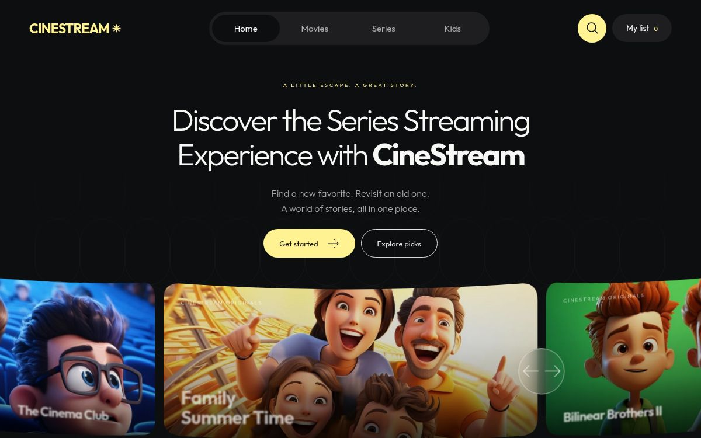

# React Movie UI

**A React movie and TV streaming UI starter with TypeScript, TanStack Query and cinematic carousels.**



*Actual screenshot of an earlier CineStream demo build. Branding and artwork differ from the downloadable template, which uses abstract placeholder artwork.*

[راهنمای فارسی](README.fa.md) · [Asset licenses](CREDITS.md) · [MIT implementation license](LICENSE)

Build a movie discovery interface, explore animated sliders, or adapt the components for your own catalog. This is a complete Vite starter app: clone it, customize it and deploy the static build. No API key is needed to run the demo.

The bundled movie artwork consists of original abstract SVG placeholders.

## Features

- Expanding hero carousel with directional transitions, staged text entrances, autoplay, swipe and keyboard controls.
- Curved recommendation carousel with a bright active card and shaded neighboring cards.
- Movie rows moving in opposite directions; short collections display each title once.
- Scroll reveals, pause controls and support for the system's reduced-motion preference.
- Search, category filters and a watchlist persisted in local storage.
- Movie and series detail pages with cast, credits, technical information and related titles.
- Season selection, expandable episode lists and sample video playback.
- Direct title links, refresh and browser Back/Forward navigation.
- TanStack Query caching, request cancellation, response validation, loading, error and retry states.

## Stack

React 19 · TypeScript · TanStack Query 5 · Vite 6 · CSS

Animations use CSS and browser APIs. Navigation uses the History API. Component tests use Testing Library, JSDOM and Node's test runner through `tsx`.

## Quick start

Install a supported Node.js LTS version and npm; the project requires Node.js 20 or newer.

```sh
git clone https://github.com/rihwwn/react-movie-ui.git
cd react-movie-ui
npm ci
npm run dev
```

Open **http://localhost:4173**. No environment variables or backend are required for this demo.

| Command | Purpose |
| --- | --- |
| `npm run dev` | Start Vite with hot reload |
| `npm test` | Run the behavior and catalog tests |
| `npm run typecheck` | Check TypeScript |
| `npm run build` | Type-check and build into `dist/` |
| `npm run preview` | Serve the production build locally |

Development and preview use the same port. Stop one before starting the other.

## Customize

| File | What to change |
| --- | --- |
| `src/content.ts` | Brand, copy and featured/recommended title IDs |
| `public/catalog.json` | Titles, categories, summaries, ratings and artwork paths |
| `src/titleDetails.ts` | Cast, lead credits, country and demo episode counts |
| `src/styles.css` | Layout, colors, typography, responsive rules and motion |
| `src/components/Carousel.tsx` | Hero and recommendation slider behavior |
| `src/components/TitlePage.tsx` | Details, seasons, episodes and the sample player |
| `src/catalog.ts` | Data types, validation, fetch endpoint and Query configuration |

Keep IDs in `content.ts` and `titleDetails.ts` in sync with the catalog when replacing the demo data. Components and their styles can also be copied into an existing React app; this release does not provide an npm component package.

### Connect your API

The demo fetches `/catalog.json`. A catalog entry has this shape:

```ts
{
  id: 'my-film',
  title: 'My Film',
  image: 'assets/my-film.svg',
  backdrop: 'assets/my-film-backdrop.jpg', // optional
  year: 2026,
  duration: '1h 45m',
  language: 'English',
  rating: '4.5',
  categories: ['Movies'],
  genre: 'Adventure · Drama',
  description: 'Your licensed catalog summary.'
}
```

Allowed categories are `Movies`, `TV Shows`, `Animation`, `Anime` and `Kids`. IDs must be unique. Local artwork paths must match `assets/<lowercase-letters-and-hyphens>.<svg|jpg|png|webp>`.

Replace `loadCatalog`'s endpoint in `src/catalog.ts` and adapt its validator to your provider's response. Remote image URLs are intentionally rejected by the current local-asset contract; allow only your expected image origins when adapting it. Update `TitlePage.tsx` to use authorized playback URLs instead of the shared sample clip. Keep provider secrets on your server.

### Deploy

Run `npm run build`, then serve **`dist/`** from the root of a static website. Title URLs use query parameters, for example `/?title=dragons`, so title navigation does not require SPA path rewrites.

The current absolute asset and navigation URLs expect a root deployment. GitHub project Pages subdirectories require URL/base adjustments before deployment.

### Cloudflare Workers from GitHub

The included `wrangler.jsonc` serves `dist/` using Workers Static Assets. No Worker script, account ID or secret is stored in this repository.

In Cloudflare's **Workers & Pages** dashboard, import the GitHub repository and use these settings:

| Setting | Value |
| --- | --- |
| Git repository | `rihwwn/react-movie-ui` (or your own copy) |
| Production branch | `main` |
| Worker name | `react-movie-ui` |
| Root directory | Repository root; leave blank or use `/` |
| Build command | `npm run build` |
| Deploy command | `npx wrangler@4.158.0 deploy` |
| Build variable | `NODE_VERSION=24` |

The Worker name must match `name` in `wrangler.jsonc`; change both if you choose another name. Cloudflare installs dependencies from the committed lockfile. After the first deployment, pushes to the connected `main` branch trigger a new build and deployment. The dashboard provides the actual `workers.dev` URL once deployment succeeds.

For a manual deployment on Node.js 22 or newer, build the app, sign in to your own Cloudflare account, then deploy:

```sh
npm run build
npx wrangler@4.158.0 login
npx wrangler@4.158.0 deploy
```

The current app uses query-based title links, so no SPA fallback setting is needed. Credentials and local Wrangler state are ignored by Git. See Cloudflare's [Workers Builds settings](https://developers.cloudflare.com/workers/ci-cd/builds/configuration/) and [Static Assets configuration](https://developers.cloudflare.com/workers/static-assets/binding/) for the deployment contract.

## Demo limits

The 23-title catalog is a manually curated snapshot. Scores, season totals, episode counts and episode runtimes are illustrative, not IMDb/TMDB statistics. Every film and episode plays the same CC0 sample clip. Poster and backdrop SVGs are placeholders, not official artwork.

Watchlists are stored in the current browser under `react-movie-ui-watchlist`; there is no account or server synchronization. This is a web interface, with no production streaming backend, subscription system, Flutter application or television app included.

## License

The implementation and original placeholder SVGs are provided under [MIT](LICENSE). Film trademarks and third-party content are not granted rights by that license. Fonts and video retain their own licenses; see [asset licenses](CREDITS.md) and [catalog sources](CATALOG-SOURCES.md).

## Contributing

Issues and focused pull requests are welcome. Describe the behavior you are changing, include a screenshot or short recording for visual changes, and run `npm test` and `npm run build` before submitting. Never commit API secrets or artwork you do not have permission to redistribute.
